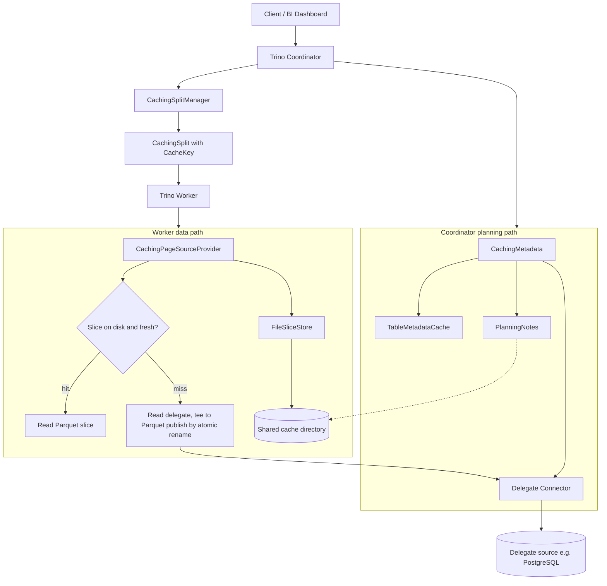
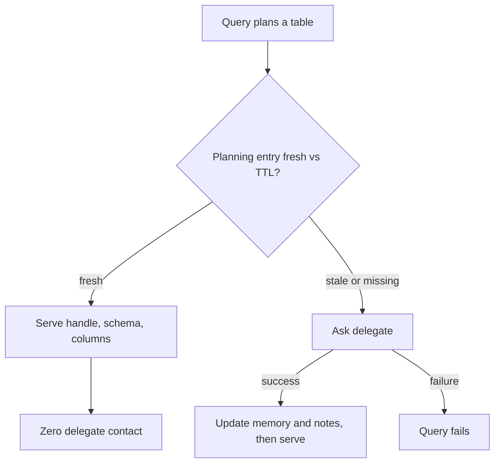
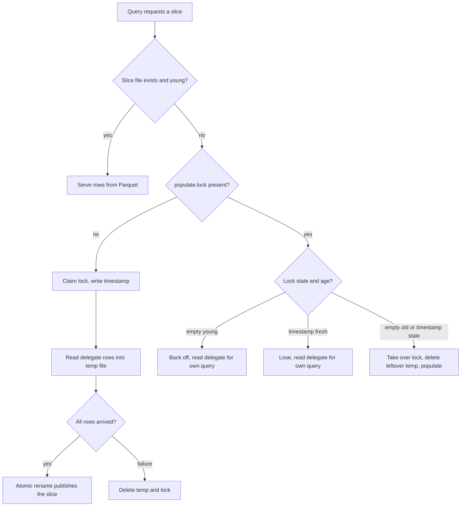

# TRACE: Trino Aware Analytic Cache Engine
### Connector-Agnostic Semantic Partition Cache for Trino

---

## 1. Executive Summary & Problem Statement

Trino is widely used to federate queries across transactional databases (PostgreSQL, MySQL, Oracle), data lakes (Iceberg, Delta Lake, Hive), and external APIs. However, analytical and business intelligence (BI) workloads suffer from critical inefficiencies:

1. **Repetitive Temporal Overlap:** BI dashboards repeatedly query overlapping time windows (e.g., "trailing 30 days"). 29 of those 30 days represent static historical data, yet upstream systems are re-scanned repeatedly.
2. **Upstream Source Contention & Cost:** Running analytical aggregations directly against operational RDBMS instances spikes CPU usage, causes lock contention, or incurs heavy API egress/scan charges.
3. **Fragility of Result Caching:** Traditional query result caches (raw SQL hashing) invalidate on minor changes (e.g., whitespace, column aliases, extending a date range by one day, or adding a column).
4. **Blindness of File/Block Caches:** File-level block caches (e.g., Alluxio, Rubix) operate strictly on raw byte offsets of object-store files. They do not understand relational schemas, cannot optimize non-file sources like JDBC/RDBMS, and suffer from cache pollution.

**TRACE** is a partition-aware semantic caching plugin for Trino. Implemented as an SPI wrapper connector, it intercepts query constraints, decomposes requests into discrete partition slices, reads warm slices directly from worker storage, and fetches only uncached deltas from source databases.

> **Status note.** This document describes the architecture as implemented. The task tracker
> (`docs/tasks/plan.md`) is the authoritative source for scope and sequencing; where this file
> once sketched future mechanisms (registry, YAML rules, SIEVE), those now appear only in their
> landed form or are explicitly marked as planned.

---

## 2. High-Level Architecture

TRACE sits inside the Trino engine via the standard SPI, wrapping delegate connectors (e.g., PostgreSQL) without requiring engine forks or proxy layers.



The layers, in query order: the coordinator's `CachingMetadata` serves planning metadata from the TTL-governed cache and planning notes, contacting the delegate only for stale or unknown entries; `CachingSplitManager` wraps the delegate's work tickets in `CachingSplit`s carrying the cache key and column layout; the worker's `CachingPageSourceProvider` resolves each split against the shared cache directory — a hit reads the Parquet slice from disk, a miss reads the delegate and tees the rows into a new slice file, published by atomic rename.

Key components:

| Component | Responsibility |
|---|---|
| `CachingConnector` | SPI proxy; holds connector-lifetime state (metadata cache, planning notes, TTL config) and threads it into per-transaction components |
| `CachingMetadata` | Cache-first planning (TTL-governed); predicate pushdown; remembers delegate handles per partition domain |
| `CachingSplitManager` | Wraps delegate splits in `CachingSplit` (cache key + column layout + types); outage replay of remembered batches |
| `CachingPageSourceProvider` | Slice lookup, disk reads (Parquet), populate-and-publish, TTL expiry, trust guard |
| `FileSliceStore` | Worker-local Parquet slice storage on the cache directory; startup index, temp+publish writes |
| `TableMetadataCache` | Connector-lifetime planning entries: delegate handle, columns, types, schema, per-domain filtered handles |
| `PlanningNotes` | Durable sidecar files: table notes and slice notes next to the data they describe |
| `OutageSafeSplitManager` | Replays the last known split batch for a slice when delegate split generation fails |

---

## 3. Core Mechanisms

### 3.1 Declarative Semantic Partitioning
Non-lakehouse sources (e.g., PostgreSQL) lack native partition metadata. TRACE bridges this gap declaratively at the catalog level: the catalog config names each cacheable table and its partition columns.

* **Per-table grain (ADR-013):** `cache.partition-column.<schema>.<table>` is a JSON array naming the slice grain, e.g. `["region"]` or `["day", "region"]`. Tables without an entry are never cached for data.
* **Slice identity:** the conjunction of the grain-column domains present in a query's filter (partial grains produce coarser slices — ADR-013). The identity is carried by `CacheKey(table, partition, version)`, which also renders the on-disk directory path deterministically (ADR-006).
* **Sub-bucketing (planned, T11):** subdividing coarse JDBC splits into per-range buckets for parallelism. Not yet implemented; the key layout reserves room for it.

### 3.2 Cache-First Planning (TTL-Governed)
Planning metadata — the delegate table handle, column layout, types, and table schema — is held in a connector-lifetime cache (`TableMetadataCache`) and persisted to planning notes (`PlanningNotes`) beside the data.



* **Cache-first rule (decision 8):** a fresh entry plans with zero delegate contact — including the statistics call (always empty for known tables) and the per-query predicate pushdown, which is served from the remembered filtered handle for the query's partition domain. An expired entry refreshes from the delegate; if the delegate fails, the query fails. There is no grace window.
* **Tables without a `cache.refresh` entry** plan conservatively: every query contacts the delegate, and slices never expire by time.
* **Planning notes (T17):** a table note (delegate handle, columns, types, schema shape) and a slice note (the delegate's filtered handle per partition domain) are written on change only, beside the data they describe, and read lazily on an in-memory miss. They carry fresh entries across a coordinator restart. Delegate objects travel as `{type, json}` envelopes; the JDBC handle keeps only its plain relation shape, because its full creator graph needs engine-internal serdes.
* **Trust flag:** a handle rebuilt from a note has lost the delegate-side predicate. It may serve a cache hit but never drives a delegate read presented as filtered (see §3.4). It is upgraded through the delegate whenever the same cycle proves the delegate reachable.

### 3.3 Data Path: Slice Lookup, Populate, Single-Flight Publish
The query's slice identity is looked up directly on the shared cache directory — no registry: the lookup is a filesystem stat on the path derived from the `CacheKey`.



* **Single-flight populate (T14):** the lock file's two states — empty ("claimed, not started") and timestamp ("populate running, heartbeat refreshed on a timer") — plus its modification time drive a four-row decision: young-empty backs off, old-empty takes over, fresh-timestamp loses, stale-timestamp takes over. The thresholds are code constants: the heartbeat bounds crash-detection latency, which the implementation controls, not populate duration, which it does not. Takeover replaces the lock by atomic rename, never in-place writes. Losers never wait: their users get correct rows read from the delegate, and the winner's publish serves everyone after.
* **Publish:** temp-file + atomic rename. Readers see a complete old or complete new file, never partial content. A worker dying mid-populate leaves a stale lock and temp file that the next miss cleans up after the heartbeat window.
* **Duplicate reads during a burst are accepted (decision 8):** the cache is an accelerator, not the delegate's shield. A query storm on a cold partition is the delegate's normal workload; if it matters in production, the answer is a serving layer, not cache intelligence (arch.md §3.6).

### 3.4 Correctness Guards
* **Untrusted-handle guard:** a delegate handle rebuilt from a planning note has lost the delegate-side predicate. It may serve a cache hit (the slice bytes are correct) but the page source refuses to drive a delegate read presented as filtered — it throws a clear error instead of serving unfiltered rows under a filtered scan. applyFilter upgrades an untrusted remembered handle through the delegate whenever the same cycle proves the delegate reachable.
* **TTL expiry (ADR-007 version:none, T9):** a slice older than its table's refresh window reads as absent, so the next query repopulates it in place. Planning entries expire the same way. The refresh window is per table (`cache.refresh.<schema>.<table>`); unset means planning always contacts the delegate and slices never expire by time.
* **Startup index (T7, ADR-011):** workers scan the cache directory at startup and keep every valid slice — persist, do not wipe. The restart-survival e2e checks assert slices are served from disk with no delegate reads after a worker restart.
* **Schema mismatch:** a cached slice whose Parquet schema no longer matches the requested layout is invalidated and treated as a miss.

### 3.5 Eviction: The SIEVE Algorithm (Planned, T13)
Rather than traditional LRU (which incurs high lock contention and pointer mutation on every read hit), the plan adopts the **SIEVE** cache eviction algorithm over slice files:
* Operates on a single FIFO queue with a single eviction pointer (`hand`).
* Cache hits flip a single atomic `visited` bit without acquiring write locks or moving nodes.
* On eviction, the `hand` scans nodes: if `visited == 1`, it resets to `0`; if `visited == 0`, it evicts the slice.
* Rapidly filters out "one-hit wonder" full table scans while preserving frequently queried operational slices.

**Status: planned (T13), not yet implemented.** Disk usage today is bounded only by the per-slice size guard and the refresh-window repopulation.

### 3.6 Role Boundary: The Cache Is an Accelerator, Not a Shield
The cache exists to make repeated reads cheap. It does not exist to protect the delegate from query storms, and it must never be engineered into one.

* **Failure semantics.** If the delegate is unavailable, queries may fail. The fallbacks that exist (metadata serving) are best-effort behavior, never a promise: the cache is a fallback, never a freeze and never a replacement.
* **Storm semantics.** A burst of concurrent cold misses on the same slice populates exactly once and reads the delegate for the rest of the burst (single-flight populate, no waiting). Without the cache, that burst would have hit the delegate with every query anyway; the cache is never worse than no cache, and once the first populate publishes, the disk serves everyone.
* **Why no queueing.** A component that admits, queues, and sheds query load is a serving layer: a first-class query surface with its own capacity model, freshness guarantees, and availability story. That is a different product. Bolting admission control onto a transparent cache would add every failure mode of a serving layer while remaining a poor imitation of one. If a workload ever needs a shield for its delegate, the right answer is a serving layer (materialized views, read replicas, a queryable store) that applications are pointed at deliberately.

---

## 4. Repository & Packaging Structure

TRACE is developed as an isolated SPI module without cloning or forking Trino. It depends on the Trino SPI artifacts marked `provided` — the delegate connectors are **not** build-time dependencies, because Trino stopped publishing connector plugin artifacts to Maven Central from 477 onward.

The delegate plugin is resolved reflectively by class name at runtime (§6). Trino gives every plugin directory its own classloader, so a separately installed delegate plugin is **not** visible to the wrapper — the delegate's jars must be copied into the wrapper's own plugin directory **at deploy time**. They are already on the cluster (shipped with the Trino distribution), so they are version-matched to the runtime SPI by construction; no build-time fetching or version pinning is needed.

Two Trino constraints the packaging must respect:
- Every plugin directory must contain at least one `io.trino.spi.Plugin` service provider (`PluginManager.loadPlugin` fails otherwise), so the wrapper's generated `-services.jar` must be present.
- Duplicate connector registration is fatal (`DefaultCatalogFactory.addConnectorFactory`), so the delegate `-services.jar` files are excluded from the copy — otherwise the delegate is registered as a top-level connector and collides with its own plugin directory. For the same reason the wrapper is installed in exactly **one** plugin directory, never copied into each delegate's directory.

Delegate plugins installed separately on the cluster are otherwise irrelevant to the wrapper: there is no conflict because the wrapper directory does not register the delegate connector names.

The plugin is **version-locked**: the wrapper's own SPI usage is only valid on the Trino version it was built against (true of any Trino plugin — the SPI is not stable across releases). `CachingConnectorFactory` verifies this at catalog creation via `ConnectorContext.getSpiVersion()` and fails fast with an actionable message instead of a query-time `NoSuchMethodError`. Upgrading Trino means bumping `trino.version`, rebuilding, and redeploying the wrapper jars.

```text
scent/
|-- pom.xml
|-- README.md
|-- docs/                                  # ADRs, issues, task tracker, this document
|-- e2e/                                   # docker-compose stack, query runner, e2e suite
`-- src/
    |-- main/
    |   |-- java/com/scent/trino/
    |   |   |-- CachePlugin.java                # Registered entry point in META-INF
    |   |   |-- CachingConnectorFactory.java    # Version check, config parsing, wiring
    |   |   |-- CachingConnector.java           # SPI proxy; connector-lifetime state
    |   |   |-- CachingMetadata.java            # Cache-first planning, pushdown, trust
    |   |   |-- CachingSplitManager.java        # CachingSplit emission, batch memory
    |   |   |-- OutageSafeSplitManager.java     # Split-batch replay on delegate failure
    |   |   |-- CachingPageSourceProvider.java  # Slice lookup, populate, trust guard
    |   |   |-- CachingTableHandle.java         # Handle + domain + columns + trust flag
    |   |   |-- CachingSplit.java               # CacheKey + layout riding the delegate split
    |   |   |-- CacheKey.java                   # Slice identity; canonical path rendering
    |   |   |-- TableMetadataCache.java         # Connector-lifetime planning entries
    |   |   |-- PlanningNotes.java              # Durable sidecar notes (T17)
    |   |   |-- FileSliceStore.java             # Parquet slice storage, TTL, temp+publish
    |   |   |-- ParquetSliceWriter.java         # Streaming Parquet write session
    |   |   `-- ParquetSliceReader.java         # Parquet read-back into Trino pages
    |   `-- resources/
    |       `-- META-INF/services/
    |           `-- io.trino.spi.Plugin         # ServiceLoader declaration
    `-- test/
        `-- java/com/scent/trino/cache/         # 97 unit tests
```

---

## 5. Configuration Specification

### 5.1 Catalog Definition (`/etc/trino/catalog/scent.properties`)

```properties
# Wrapper Connector Configuration
connector.name=cache_wrapper

# Delegate connector name, resolved to its Plugin class reflectively at runtime
delegate.connector.name=postgresql

# Delegate credentials (passed straight through to the delegate connector)
connection-url=jdbc:postgresql://postgres:5432/test
connection-user=test
connection-password=test

# Cache directory (bind-mounted/shared in multi-node deployments)
cache.root=/tmp/scent-cache

# Per-slice size guard: slices larger than this are skipped, not cached
cache.max-bytes=67108864

# Per-table slice grain (ADR-013): JSON array naming the partition columns.
# Tables without an entry are never cached for data.
cache.partition-column.public.metrics=["region"]
cache.partition-column.public.regions=["region"]

# Per-table bounded staleness (ADR-007 version:none, T9): slices and planning
# metadata are served from the cache for this window, then refreshed from the
# delegate. Tables without an entry never expire by time.
cache.refresh.public.metrics=3m
```

**Config rules.**
* Per-table keys follow the `cache.<setting>.<schema>.<table>` pattern (`partition-column`, `refresh`).
* Unknown or malformed values fail fast at catalog creation with an actionable message.
* There is no eviction configuration yet (T13 owns the disk-quota knob), no YAML rules file, and no other cache knobs — the design keeps config minimal by decision (decision 8 and the T17 no-store-interface choice).

---

## 6. Implementation Shape

The implementation is a single Maven module (`com.scent:scent-trino-plugin`, packaged `trino-plugin`, Java 25, Trino 483) built with the Trino Maven plugin, which runs an SPI-dependency check so the plugin cannot accidentally compile against engine-internal classes. Jackson is a compile dependency (the notes serialize delegate objects); the jdk8 and guava data modules are included because delegate handles carry `Optional` and guava fields; `trino-base-jdbc` is test-scope so the planning-note round trip is verified against the real delegate handle classes.

Component wiring, all created per connector in `CachingConnectorFactory.create`:

```text
delegateConnector (resolved reflectively, §4)
  +-- FileSliceStore(maxBytes, typeManager, cacheRoot, refreshByTable)
  +-- TableMetadataCache
  +-- PlanningNotes(cacheRoot, typeManager)
  +-- refreshByTable (per-table TTL)
  v
CachingConnector  (SPI proxy holding all of the above)
  |-- getMetadata            -> CachingMetadata(delegateMetadata, partitionColumns,
  |                             captureColumnTypes=store.enabled, metadataCache,
  |                             planningNotes, refreshByTable)
  |-- getSplitManager        -> OutageSafeSplitManager(CachingSplitManager(delegateSplitManager))
  |-- getPageSourceProvider  -> CachingPageSourceProvider(delegateProvider, sliceStore)
```

Notes on non-obvious implementation constraints:
* **Serialization.** `CachingTableHandle` and `CachingSplit` ride the coordinator-worker wire through the engine's typed Jackson module. `CachingTableHandle` must keep exactly one `@JsonCreator` constructor — two annotated creators fail every task update with conflicting-creator errors. The trust flag rides the same wire as a handle property.
* **Delegate object persistence.** Planning notes store delegate objects as `{type, json}` envelopes deserialized through their own class; a polymorphic mapper misreads their delegating creators (proven with a real `JdbcTableHandle`). The JDBC handle keeps only its plain relation shape in the note, and schema columns are stored as SQL type strings rebuilt through the `TypeManager`.
* **Classloader.** The delegate plugin class is resolved reflectively at runtime because the wrapper's classloader cannot see separately installed plugin directories; the delegate jars are copied into the wrapper's directory at deploy time (§4).

---

## 7. Roadmap

The phased roadmap, task list, acceptance criteria, and design decisions live in `docs/tasks/plan.md` and `docs/tasks/todo.md` — that tracker is the single source of truth and is kept current with landed work. Summary as of this writing:

| Phase | Tasks | Status |
|---|---|---|
| 1. Baseline & measurement | T1-T3 | done |
| 2. Content-addressable cache key | T4, T5 | done |
| 3. Durable storage | T6, T7, T7b | done |
| 4. Source-outage resilience | T8 | done |
| 4.5 Durable planning notes | T17 | done |
| 5. Freshness | T9 done; T10 next | in progress |
| 6. Production hardening | T11-T16 (T15, T16 done) | pending |
| Later: storage evolution | parquet-avro → trino-parquet migration note | deferred |

Design decisions with rationale (accelerator-not-replacement, no remote metadata store, lock-file single-flight, storm handling) are recorded in plan.md's Decisions section and §3.6 of this document.
